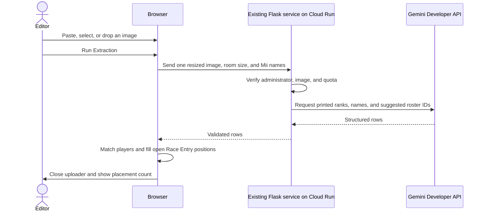

# Import race results from an image

The Gemini pilot fills placement slots for one race from a Mario Kart Wii results screenshot or phone photo. The importer reads the printed position and Mii name. The editor uses its [room-size score tables](json-format.md) to calculate points.

The pilot is available to signed-in administrators where it has been enabled in local development or staging. Use synthetic or scrubbed test images and rosters. Google receives the full selected image and the roster Mii names when you run extraction. Keep personal or confidential information out of the pilot. Manual race entry is available to all editors. [Gemini Developer API terms](https://aistudio.google.com/docs/terms)

## Enter a race

1. Fill **Teams And Players**. You can use **Paste roster** to load a Wiimmfi or Table Bot roster.
2. In **Race Entry**, set the room size. The uploader opens automatically for the selected race when its finishing positions are empty. For a race with placements, choose **Extract from Image** below **Clear all positions**.
3. Paste, select, or drop an image anywhere in the inline uploader. If the source site blocks a dragged image link, copy and paste the image or choose the downloaded file. Use **Paste image**, **Ctrl+V**, or **⌘V** for screenshots copied to the clipboard.
4. Choose **Run Extraction**. The green button dims while extraction runs. The uploader closes after a successful request and Race Entry shows how many placements were added. Correct any mistakes or fill gaps using the normal position selectors.
5. Enter the track, disconnect awards, and missing-player awards in Race Entry.

PNG, JPEG, and WebP are practical choices. Use a clear capture that shows the positions and names. If glare or perspective distortion obscures the text, try taking the photo directly facing the screen.

```text
In-game results table
┌───────────────────────────────────────────────────────────────────┐
│ 3rd       [avatar]    MS◆rodafy          [rank stars]   +10  69 pts │
│ └─ position          └─ Mii name                                   │
├───────────────────────────────────────────────────────────────────┤
│ 4th       [avatar]    bey kloshi         [rank stars]    +8  50 pts │
└───────────────────────────────────────────────────────────────────┘
```

The orange highlight carries no placement information. The importer reads the printed ranks and Mii names. A screenshot starting at 3rd can fill 3rd and later positions, and an unreadable ordinal leaves a gap.

### Extract several races

Choose **Bulk Extraction** beside **Extract from Image** to open one image slot per race. The slots appear in two columns on wide screens and stack on smaller screens. Paste, drop, or choose a file in any slot. **Run Extraction** sends the filled slots together and adds successful placements as each race finishes. Leave unused slots blank. The footer shows one numbered progress segment for each queued race and fills it when that race completes. When the run succeeds and the queue is empty, choose **Return to Editor**.

After every initial request finishes, bulk extraction retries failed requests once. Each retry starts at least five seconds after its failure, or later if the app’s rate limit requires it. Failed images remain queued for another attempt. Closing during extraction stops the queue and keeps placements that were already added.

### Roster matching and existing entries

| Situation | Race Entry behavior |
| --- | --- |
| A unique in-range rank and a unique roster match | The editor fills the position. Matching normalizes Unicode, casing, whitespace, and the fill of known symbols such as `★/☆`, `◆/◇`, `■/□`, and `●/○`. |
| A harder name has one plausible choice | The editor can use a close name or a model suggestion after accounting for other placements and disconnect awards. A sole remaining player can fill a gap in a complete results table. |
| Duplicate names, competing guesses, or unreadable ranks | The editor leaves ambiguous positions for manual entry. |
| A position already has a player, the player races in a different position, or the player has a disconnect award | The editor preserves existing entries. Use the usual Race Entry controls to correct them. |

## How extraction works



The browser resizes large images and encodes one JPEG. Flask strips metadata and sends the image, room size, and temporary roster IDs paired with nonempty Mii names. Friend codes and other match fields stay in the editor. The uploader releases the selected file when extraction starts and drops the request on close. Successful imports retain placement fields only. The app does not archive input images or model responses.

## Configure and verify the pilot

1. In AI Studio, open the Google Cloud project that owns the Gemini authorization key and enable the **Paid Tier**. Follow any prompts to link billing or fund a prepaid balance. Verify that the project shows paid billing and has active limits for `gemini-3.1-flash-lite`. Upgrading the existing project keeps its API key and the model endpoint. Use separate projects if local and staging need independent provider quotas. [AI Studio projects](https://aistudio.google.com/projects) · [Billing setup](https://aistudio.google.com/docs/billing#setup-billing) · [Rate limits](https://aistudio.google.com/rate-limit)
2. Use the existing restricted authorization key, or create one under **API Keys** for a new project. For localhost, supply it as `GEMINI_API_KEY` in the backend process environment. Set `RACE_IMAGE_IMPORT_ENABLED=true` there and restart Flask. Use the usual Firebase localhost configuration and an authorized administrator. [API keys](https://aistudio.google.com/api-keys) · [Local development](../../README.md)
3. In site project `mkw-stats`, put the staging key in Secret Manager as `ctc-staging-gemini-api-key`. Grant Secret Accessor on that specific secret to `ctc-api-staging@mkw-stats.iam.gserviceaccount.com`. Deploy the application through the existing staging pipeline, then update the staging service to pin the appropriate version. The existing image-only rollout preserves that secret binding and the pilot settings. [Runtime secret conventions](../../infra/secrets/README.md) · [Cloud Run secret configuration](https://docs.cloud.google.com/run/docs/configuring/services/secrets)

```sh
gcloud run services update ctc-stats-api-staging \
  --project=mkw-stats --region=us-central1 \
  --update-secrets=GEMINI_API_KEY=ctc-staging-gemini-api-key:1 \
  --update-env-vars=RACE_IMAGE_IMPORT_ENABLED=true
```

| Backend setting | Default |
| --- | --- |
| `RACE_IMAGE_IMPORT_ENABLED` | `false` |
| `GEMINI_API_KEY` | Unset |
| `RACE_IMAGE_REQUESTS_PER_MINUTE` | 24 attempts shared by the environment |
| `RACE_IMAGE_REQUESTS_PER_DAY` | 200 attempts shared by the environment, reset at midnight Pacific |
| `RACE_IMAGE_REQUESTS_PER_USER_HOUR` | 60 attempts per administrator |

These application caps assume paid-tier usage. Set the shared limits using the project's active quota and your usage budget. If local and staging share one Gemini project, account for both environments when setting their budgets. The PostgreSQL counters are reserved atomically across Cloud Run instances, before calling Google. A failed upstream attempt consumes a reservation, and requests are issued once per explicit read. To suspend the pilot, set `RACE_IMAGE_IMPORT_ENABLED=false` on the service.

In staging, sign in as a pilot administrator, open the editor, and read one scrubbed image. Check the populated Race Entry positions against the original. In a signed-out window, confirm opening **Extract from Image** prompts for administrator sign-in and manual race entry is available. The public rollout needs a separate review of the provider's age, regional, and data-use terms. [Gemini Developer API terms](https://aistudio.google.com/docs/terms)

### Monitor usage and errors

Use the [Google Cloud Logs Explorer](https://console.cloud.google.com/logs/query?project=mkw-stats) filter below to see individual Gemini attempts and app quota rejections. Open the corresponding Cloud Run request log using the correlated trace or request ID. A provider attempt includes outcome, latency in milliseconds, provider HTTP status, and token counts when returned. A refused local quota has no provider attempt. Screenshots, roster names, prompts, responses, and credentials are excluded from the Gemini logs.

```text
resource.type="cloud_run_revision"
resource.labels.service_name="ctc-stats-api-staging"
(jsonPayload.event="race_image_gemini_attempt" OR
 jsonPayload.event="race_image_quota_rejected")
```

Use **Cloud Monitoring** log-based counters for attempts and errors by `outcome`, and a log-based distribution on `jsonPayload.duration_ms` for p95 provider latency. Track `provider_quota` separately from `app_quota`. AI Studio shows the Gemini project's aggregate activity and active limits. [Log-based metrics](https://docs.cloud.google.com/logging/docs/logs-based-metrics) · [AI Studio usage](https://aistudio.google.com/usage) · [AI Studio rate limits](https://aistudio.google.com/rate-limit)

### Evaluate recognition quality

The [browser tests](../../frontend/e2e/race-results-image.spec.ts) stub Gemini responses and cover file selection, clipboard paste, drag and drop, direct placement, and selected-race isolation. The [Flask tests](../../backend/test_race_results_image.py) stub the provider and cover access, malformed input, quota rejection, provider errors, and result validation.

For a live pilot, record end-to-end processing time, wrong preselected placements, and how many manual edits are needed. Use scrubbed fixtures with different room sizes, original and compressed captures, slight phone tilt, cropped or unreadable ordinals, Greek and Japanese text, decorative symbols, and duplicate names. Compare the time to finish Race Entry to manual entry on a desktop and a typical phone.
